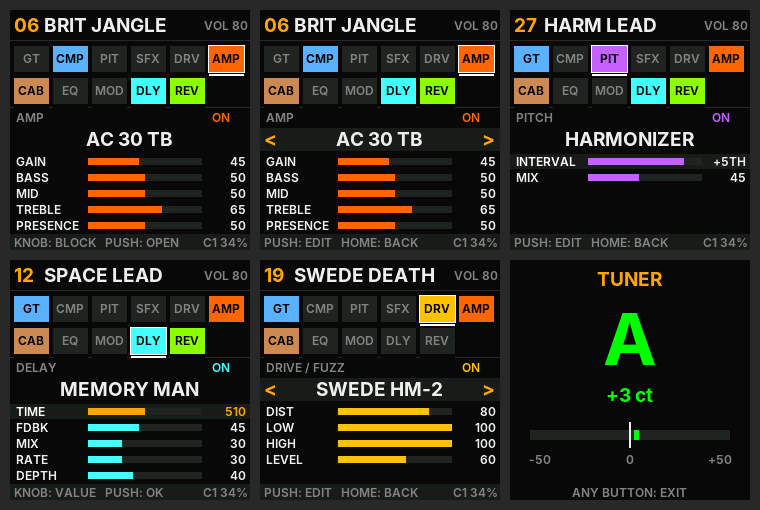

# OpenPocket — sons et commandes (v28)

L'interface est entièrement en anglais depuis la v23.

## La chaîne (11 blocs, 118 modèles)
`GT → CMP → PIT → SFX → DRV → AMP → CAB → EQ → MOD → DLY → REV`

Chaque bloc a un **type** (le modèle), un état **ON/OFF** et jusqu'à **5 réglages (0–100)**. Quand un chiffre seul
ne veut rien dire, l'écran affiche la vraie valeur : intervalle (`+5TH`), demi-tons (`-7`), temps en ms (`510`),
têtes de lecture (`1+2`), dB de l'EQ (`+6`), bits (`8`), `SLOW`/`FAST` pour le rotary.

Les noms évoquent les appareils célèbres dont les sons s'inspirent (voicings tirés d'analyses de circuits
publiées : ElectroSmash, Electric Druid, R.G. Keen, Rob Robinette, Duncan's Tone Stack Calculator, courbes
Celestion/Jensen/EV/JBL, manuels Boss/Roland/Ampeg/EHX). Ce sont des modèles numériques simplifiés, pas des copies.

### AMP — 29 amplis (GAIN, BASS, MID, TREBLE, PRESENCE)
| Famille | Modèles (inspirés de) |
|---|---|
| Clean américain | TWIN CLEAN (Twin Reverb), DELUXE 65 (Deluxe Reverb), PRINCETONE (Princeton), TWO-ROCK (clean boutique) |
| Tweed / petit ampli | TWEED 59 (Bassman 5F6-A), TWEED CHAMP (Champ), SUPRO 64 (Supro, gros sag) |
| Anglais chimant | AC 30 TB (AC30 Top Boost), AC 15, CHIME 30 (Matchless) |
| Anglais rock | JTM 45, PLEXI 68 (Super Lead), BRIT 800 (JCM800), BRIT JVM, HIWATT DR (gros headroom), ORANGE 120 |
| Lead boutique | ODS LEAD (Dumble), SLO 100 (Soldano), ECSTASY (Bogner), BE LEAD (Friedman), MARK IIC+ (Mesa) |
| Moderne / metal | RECTIFIED (Dual Rectifier), 5150 LEAD, 5150 III, UBER VH4 (Diezel), EURO BALL (Engl), REVV GEN |
| Transistor / basse | JC CLEAN (Jazz Chorus, sans saturation), SVT BASS (Ampeg SVT) |

Chaque ampli = 0 à 4 étages de préampli (gain, asymétrie, filtres RC par étage) suréchantillonnés ×4, filtre
d'entrée (serrage), condensateur « bright » qui s'efface quand le gain monte, tone stack à ses propres fréquences
(creux de médiums à midi : −6 dB Fender, −3 dB Marshall, −6 dB Mesa…), présence, résonance, saturation de l'étage
de puissance et affaissement de l'alimentation (sag). Les 29 amplis sont calibrés au même volume (±0,1 dB).
Depuis la v25 : courbe de triode asymétrique (l'alternance positive sature plus tôt : harmonique 2 de −35 à −24 dB sur
le Plexi, de −33 à −18 dB sur le 5150), décalage de polarisation qui suit le jeu (le son se « comprime » sur une
attaque forte puis s'épanouit, environ 100 ms) et affaissement de l'alimentation qui atteint aussi le préampli.

### CAB — 15 baffles (BODY, BRIGHT, MIC)
1x10 OPEN · 1x12 US OPEN (Jensen C12N) · 2x10 VIBRO · 2x12 BLUE (Alnico Blue) · 2x12 BRIT (G12H) ·
4x10 TWEED (Bassman) · 4x12 GREEN (Greenback) · 4x12 T75 · 4x12 V30 (Vintage 30) · 4x12 H30 · 1x12 CREAM ·
1x15 OPEN (JBL D130) · 8x10 BASS (SVT) · 4x10 HORN (basse + tweeter) · DI (NO CAB).
Résonance du HP, creux et pics de présence relevés sur les courbes des fabricants. **MIC** déplace le micro du
bord (sombre) vers le centre (brillant).
Depuis la v25, une couche de détail (filtre FIR de 128 points, 2,9 ms) s'ajoute à chaque baffle : les résonances de
la membrane entre 1,2 et 6 kHz (propres à chaque modèle : deux baffles ne sonnent plus pareil dans les aigus), le
filtrage en peigne du micro hors axe (MIC 0 = bord du cône : creux vers 6 kHz ; MIC 100 = centre : hors de la bande
audio) et la réflexion arrière des baffles ouverts (1x10, 1x12 US, 2x10, 2x12 BLUE, 4x10 TWEED, 1x15).

### DRV — 27 drives, fuzz et boosts
| Famille | Modèles | Réglages |
|---|---|---|
| Overdrive | TS 808, TS 9, SD-1 OD, KLONE, BD BLUES, OCD DRIVE, BLUESBREAKER, KING OF TONE, ZEN DRIVE (VOICE), TIMMY (BASS, TREBLE) | DRIVE, TONE, LEVEL |
| Distorsion | RAT DIST, DS-1 DIST, DIST PLUS, SWEDE HM-2 (LOW, HIGH), METAL ZONE (LOW, HIGH) | DIST, TONE, LEVEL |
| Fuzz | MUFF PI, RAMS HEAD, GREEN RUSSIAN, FACE GERMAN., FACE SILICON, BENDER MK2, OCTAFUZZ (octave haute), FUZZ FACTORY (GATE, BIAS : crachote) | SUSTAIN/FUZZ, TONE, LEVEL |
| Boost / basse | TREBLE BOOST (Rangemaster), EP BOOST, PRECISION (TIGHT, BRIGHT : boost metal), BASS DI 7K (BLEND) | BOOST/DRIVE, TONE, LEVEL |

Chaque drive reprend la chaîne du circuit : filtre d'entrée, « shelf » du TS (les graves ne saturent pas), type
d'écrêtage (doux, asymétrique, diodes dures, germanium, LED, MOSFET, deux étages Muff, transistor affamé,
redresseur), tonalité d'origine (passe-bas, mélange LP/HP du Muff et du DS-1, pics du HM-2). Volume calibré :
à midi, chaque drive sort au même niveau que la guitare (boosts : +6 dB).

### Effets
| Bloc | Types |
|---|---|
| GT | NOISE GATE (THRESH, RELEASE) |
| CMP | SQUASH (Dyna Comp), STUDIO (parallèle, MIX), OPTO LA-2 (optique, relâche lente), SLOW SWELL (attaque effacée : effet violon) |
| PIT | OCTAVER (analogique : SUB -1, SUB -2, UP +1), POLY OCTAVE (−1 et +1 octave propres), WHAMMY (±24 demi-tons, GLIDE), HARMONIZER (intervalle fixe −OCT…+OCT), DETUNE (doublage ±cents) |
| SFX | ENVELOPE WAH (Mu-Tron), AUTO WAH (LFO, ou wah fixe avec DEPTH 0), RING MOD, BITCRUSHER, SLICER (8 motifs rythmiques), LO-FI RADIO, SQUARE SYNTH (synthé onde carrée + sub, filtre qui s'ouvre) |
| EQ | 5 BAND, GRAPHIC 5 (le « V » des Mesa), PARAMETRIC |
| MOD | CE CHORUS, DIMENSION (4 modes), FLANGER, PHASE 90, SMALL STONE, UNI-VIBE, OPTO TREMOLO, BIAS TREMOLO, HARMONIC TREM, ROTARY (Leslie, accélération réelle SLOW↔FAST), VIBRATO |
| DLY | DIGITAL, ANALOG BBD, MEMORY MAN (répétitions modulées), TAPE EP-3 (wow & flutter), SPACE ECHO (3 têtes, 7 combinaisons), REVERSE, LO-FI, DUAL TAP (noire + croche pointée) — TIME 20–1000 ms |
| REV | ROOM, HALL, CATHEDRAL, PLATE, SPRING (DRIP), SHIMMER (octave dans la queue), GATED (années 80), AMBIENT (jusqu'à 20 s) |

Les delays analogiques/bande (ANALOG, MEMORY MAN, TAPE, SPACE ECHO, LO-FI) **auto-oscillent au-dessus de
FDBK ≈ 90**, comme les vrais : baisser FDBK pour arrêter.

## 42 presets d'usine (un par style)
01 GLASS CLEAN · 02 JAZZ BOX · 03 COUNTRY SNAP · 04 TEXAS BLUES · 05 TWEED BLUES · 06 BRIT JANGLE · 07 60S PSYCH ·
08 70S ROCK · 09 80S HAIR · 10 BRIT CRUNCH · 11 SMOOTH LEAD · 12 SPACE LEAD · 13 DOTTED 8TH · 14 MARK SOLO ·
15 THRASH · 16 GROOVE METAL · 17 DJENT · 18 DOOM SLUDGE · 19 SWEDE DEATH · 20 SHOEGAZE · 21 SWELL PAD ·
22 FUNK WAH · 23 SURF · 24 SWAMP TREM · 25 VIBE ROCK · 26 ROTARY ORGAN · 27 HARM LEAD · 28 WHAMMY DIVE ·
29 OCTA FUZZ · 30 SQUARE SYNTH · 31 RING MOD · 32 LO-FI TAPE · 33 STUTTER FUZZ · 34 BITCRUSH · 35 BASS DRIVE ·
36 BASS OCTAVE · 37 TWEED CHAMP · 38 HIWATT STACK · 39 MODERN HIGH · 40 SUPRO GRIT · 41 STONER FUZZ · 42 CHIME CLEAN

## Commandes
| Commande | Action |
|---|---|
| KNOB (PARA) | chaîne : choisir le bloc · page : choisir la ligne · réglage : changer la valeur (tourner vite = pas de 5) |
| PUSH (knob) | chaîne → ouvrir le bloc · ligne type/réglage → régler · ligne ON/OFF → basculer · en réglage → valider |
| PUSH **appui long (0,8 s)** | **SAVE** : enregistrer le son actuel (voir plus bas) |
| HOME | retour à la chaîne · **appui long (0,7 s) = accordeur** |
| Footswitch droit / gauche | preset suivant / précédent |
| AMP, CAB, DLY, REV, MOD | aller directement au bloc ; 2e appui = allumer/éteindre |
| FX | parcourt DRV → SFX → PIT → CMP → GT → EQ |
| MASTER | volume de sortie |

## Accordeur
Appui long sur HOME. La ligne `IN L … R … dB` en haut indique le niveau de chaque canal de l'entrée (en dB sous le
maximum) : rien de branché, c'est le bruit de fond de la pédale ; en jouant, c'est le niveau de ta guitare.

## Entrée audio (v26–v28)
Comme le firmware officiel : entrée et sortie en 24 bits (v26), et la guitare lue sur le canal gauche seul (v28).
Le canal droit de l'entrée ne porte qu'un bruit constant (-77 dB) ; avant la v28 il était mélangé au son, et les
amplis à gros gain le transformaient en souffle constant, même sans rien de branché.

## Enregistrer ses sons (v25)
- Un `*` en haut de l'écran signale que le son a été modifié depuis le preset.
- **Appui long sur PUSH** : page SAVE. Le knob choisit l'emplacement (1 à 42, le preset en cours est proposé ; l'écran
  montre le nom du son qui sera remplacé), PUSH enregistre, HOME annule.
- Tout au bout de la liste : **RESTORE FACTORY** remet l'emplacement en cours à son preset d'usine.
- La pédale redémarre sur le dernier emplacement enregistré.
- Les sons sont gardés en flash (0xF0000–0xF4000, deux copies) : une coupure de courant pendant l'enregistrement
  laisse l'ancienne version, jamais un emplacement abîmé. Ils **survivent aux mises à jour** OpenPocket (le chargeur
  n'écrit que la zone de l'application). Le son est coupé environ 0,1 s pendant l'écriture.

En bas à droite : `C1 xx%` = charge du DSP sur le 2e cœur (`C0` = repli sur le cœur principal, `BYP` = garde-fou
de surcharge : éteindre un bloc).

## Vérifications faites sur PC (avec la libm de la pédale, `firmware/px_math.c`)
- 3 312 configurations (chaque bloc × type × réglages extrêmes, changés en cours de jeu ; signal, silence, signal
  très fort) : 0 NaN.
- 354 passes longues (3 s de corde pincée + 8 s de silence, chaque modèle à fond) : rien ne s'emballe ; seuls les
  delays à FDBK 100 tiennent leurs répétitions (voulu).
- Décaleurs de hauteur : 100 % de l'énergie sur la note visée (440 Hz, 110 Hz, −7 demi-tons) grâce à l'alignement
  de phase à chaque fondu (SOLA).
- Silence numérique : plus de nombres dénormalisés (le silence coûtait 25× plus cher en calcul sur PC).
- Mémoire : moteur 326 Ko dans la zone POOL de 344 Ko.
- Enregistrement des presets (`tests/test_store.c`) : coupure de courant simulée à 1 286 moments d'un
  enregistrement → ancienne version gardée 578 fois, nouvelle 708 fois, jamais d'emplacement abîmé ; aucune écriture
  hors de la zone des presets.
- Coût : la v25 chargeait trop la pédale (DOOM SLUDGE en BYP à 89 % sur la v26). La v27 calcule les baffles et
  l'ampli autrement (même son, à 0,5 dB près en moyenne) : environ −16 % sur DOOM SLUDGE, −19 % sur GROOVE METAL,
  soit +16 à +22 % par rapport à la v24 (garde-fou BYP à 85 %).
- Coût estimé vs v22 : +15 % sur un preset typique (drive + ampli 4 étages + baffle), +50 % avec les 11 blocs allumés
  et les effets les plus lourds.

## Mise à jour par USB (v24)
La pédale apparaît en USB comme périphérique MIDI « OpenPocket ». La page d'installation (`docs/index.html`, publiée
sur GitHub Pages) la reconnaît, installe une nouvelle version ou ramène la pédale au firmware officiel. Pendant une
mise à jour, l'écran affiche `UPDATE` et l'étape en cours ; si elle échoue, `FAILED -N` puis la pédale redémarre
sur l'ancienne version (rien n'est écrit avant que la pédale ait vérifié le paquet).
